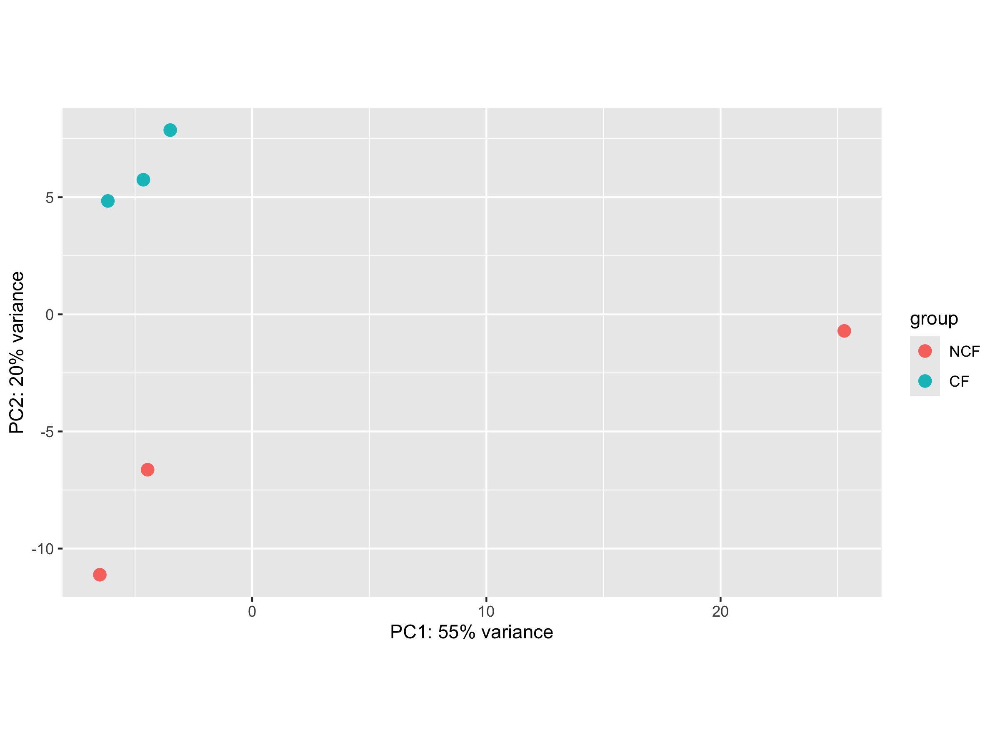
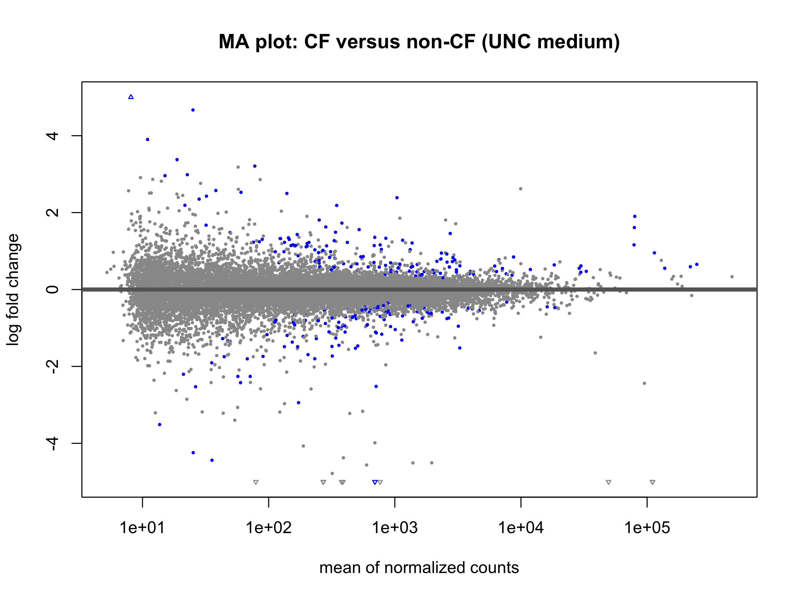
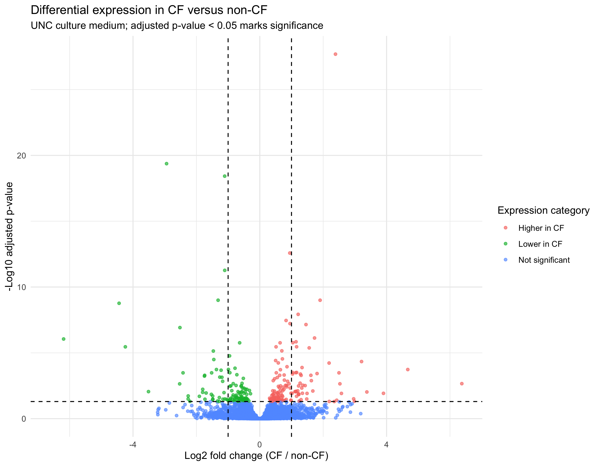
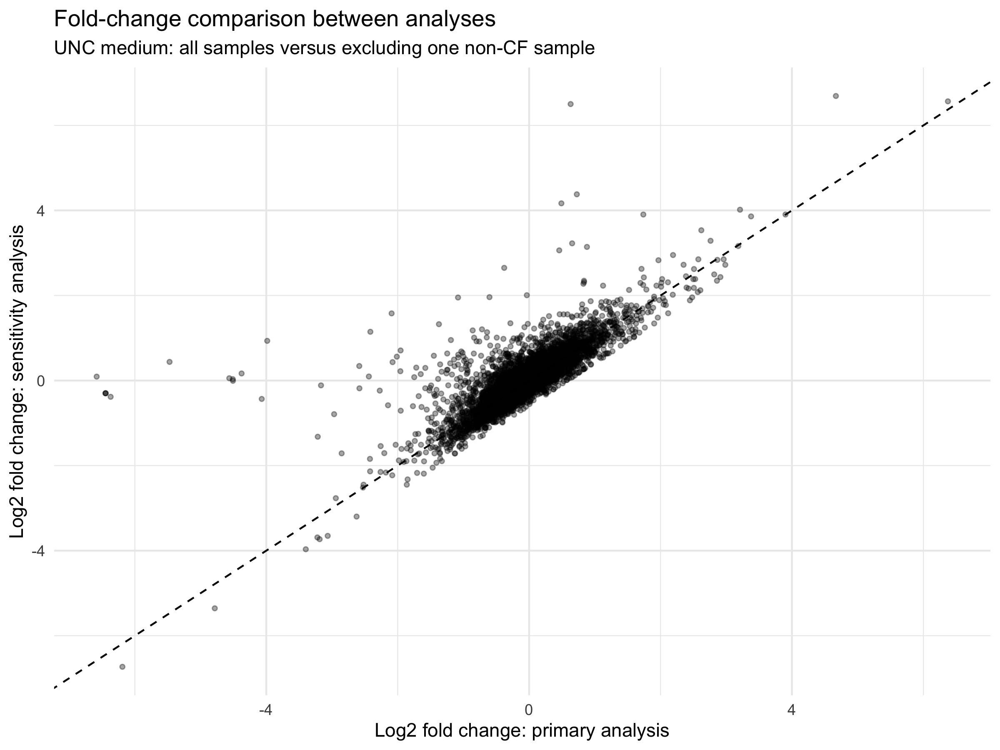
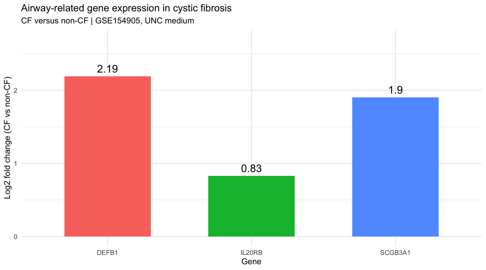
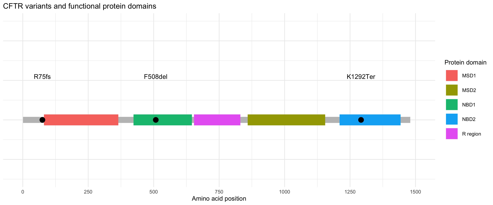

# Cystic Fibrosis Transcriptomic Analysis

## Project Overview

This project investigates differential gene expression between cystic fibrosis (CF) and non-CF samples using RNA sequencing data and computational bioinformatics approaches.

The analysis was conducted using R/RStudio, incorporating differential expression analysis, exploratory data analysis, statistical visualisation and sensitivity analysis.

## Research Objectives

- Identify genes showing differential expression between CF and non-CF samples.
- Investigate disease-associated transcriptional changes.
- Assess the robustness of differential expression results to the exclusion of an individual sample.
- Explore selected airway-associated genes and their potential biological relevance.
- Visualise CFTR variants in relation to functional protein domains.

## Dataset

**Source:** NCBI Gene Expression Omnibus (GEO)

**Accession:** GSE154905

**Comparison:** CF versus non-CF samples under UNC medium conditions.

## Computational Methods

**R and RStudio**

- DESeq2 for differential gene expression analysis.
- Normalisation and filtering of RNA-seq count data.
- Interpretation of log2 fold changes and adjusted p-values.
- Principal component analysis (PCA) for exploratory sample assessment.
- MA plots, volcano plots and gene-level visualisations.
- Sensitivity analysis comparing primary and sample-exclusion results.
- CFTR variant retrieval and protein-domain mapping.

## Selected Findings and Visualisations

The project includes visualisations of differential gene expression, selected airway-related genes (DEFB1, IL20RB and SCGB3A1), and CFTR variants.

The sensitivity analysis examines how excluding one non-CF sample influences estimated gene expression changes.

## Research Skills Demonstrated

- R programming and bioinformatics
- RNA-seq differential expression analysis
- Statistical interpretation and data visualisation
- Exploratory data analysis and quality control
- Sensitivity analysis and reproducibility assessment
- Integration of genomic annotations with protein-domain information

## Limitations

Differential gene expression does not establish causality. Results are specific to the analysed dataset, experimental conditions and statistical design.

This repository contains an exploratory research workflow 

## Analysis and Visualisations

### 1. Principal Component Analysis (PCA)
Exploratory analysis of sample variation and potential clustering.

### 2. Differential Gene Expression — MA Plot
Visualisation of log2 fold changes against mean normalised counts.

### 3. Volcano Plot
Visualisation of differential expression effect sizes and statistical significance.

### 4. Sensitivity Analysis
Comparison of log2 fold changes before and after excluding one non-CF sample to assess the influence of sample selection.

### 5. Airway-Related Gene Expression
Log2 fold changes for selected genes: DEFB1, IL20RB and SCGB3A1.

### 6. CFTR Variants and Protein Domains
Visualisation of selected CFTR variants relative to functional protein domains.

## R Analysis Scripts

The R scripts used in this project are available in the [`scripts`](scripts/) folder.

- [`00_original_exploratory.R`](scripts/00_original_exploratory.R) — original exploratory analysis.
- [`01_deseq2_analysis.R`](scripts/01_deseq2_analysis.R) — reorganised DESeq2 analysis workflow.

The reorganised script is a documented starting point and has not yet been independently validated against the original input data.
